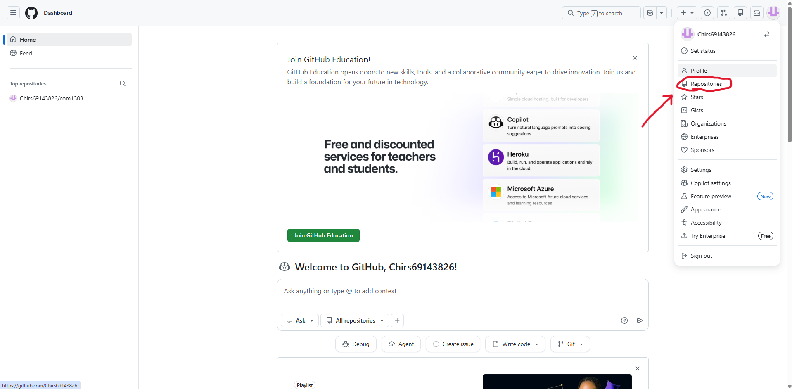
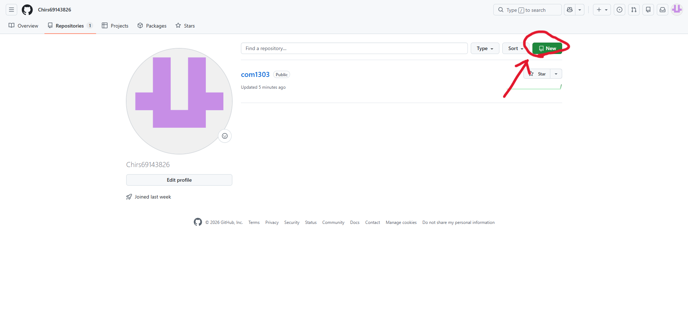
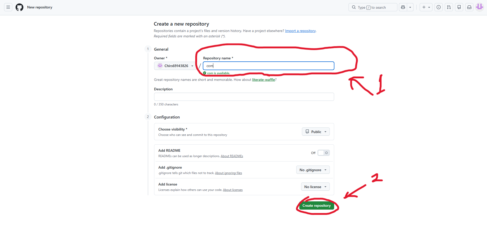

# สัปดาที่ 1
## 69143826 นายชาคริส พงศ์วรกิจ
## COM1303 การพัฒนาเว็บขั้นพื้นฐาน

1.Gitคืออะไร

-gitคือระบบควบคุมเวอร์ชันแบบกระจาย

2.การทำงานของเว็บไซต์ทำงานอย่างไร

-ทำหน้าที่เป็นแหล่งฝากและจัดการโค้ดโดยใช้ Git เป็นแกนกลางหลักในการทำงาน

3.เว็บไซต์ต่างจากเว็บแอพพลิเคชั่นอย่างไร

-GitHubแอปพลิเคชันเป็นโปรแกรมที่ติดตั้งลงบนเครื่องคอมพิวเตอร์ไม่ต้องใช้อินเทอร์เน็ตตอนใช้งาน แต่ต้องต่ออินเทอร์เน็ตเฉพาะตอนอัปโหลดหรือดาวโหลด ต่างจากเว็บไซต์ที่ต้องใช้อินเทอร์เน็ตในทุกขั้นตอน

4.ให้สร้างคู่มือการใช้งาน Github

สร้างบัญชีและเข้าสู่ระบบแล้วกดไปที่โปรไฟแล้วกดไปที่Repositories

และกดที่Newเพื่อสร้างโปรเจคใหม่ 

ก่อนจะตั้งชื่อที่ไม่ซ้ำกันก่อนจะเลื่อนลงไปกดCreate Repository

และหากเขียนเสร็จก็กดที่Commitเพื่อเซฟไฟ หลังจากที่เซฟไฟก็สามารถคัดลอกลิ้งเพื่อแบ่งให้คนอื่นดูด้วยได้

[link](https://github.com/Chirs69143826/com1303.git)
